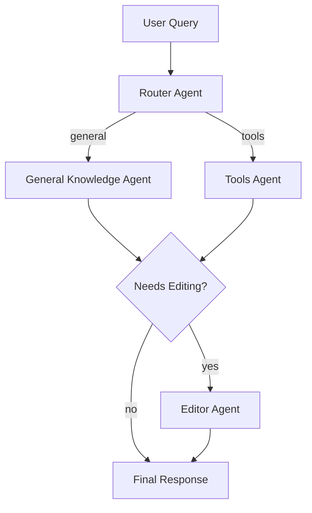
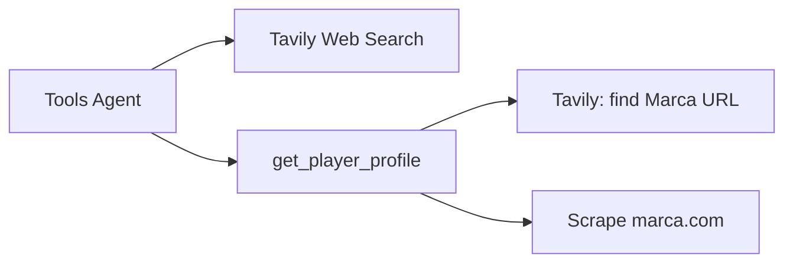
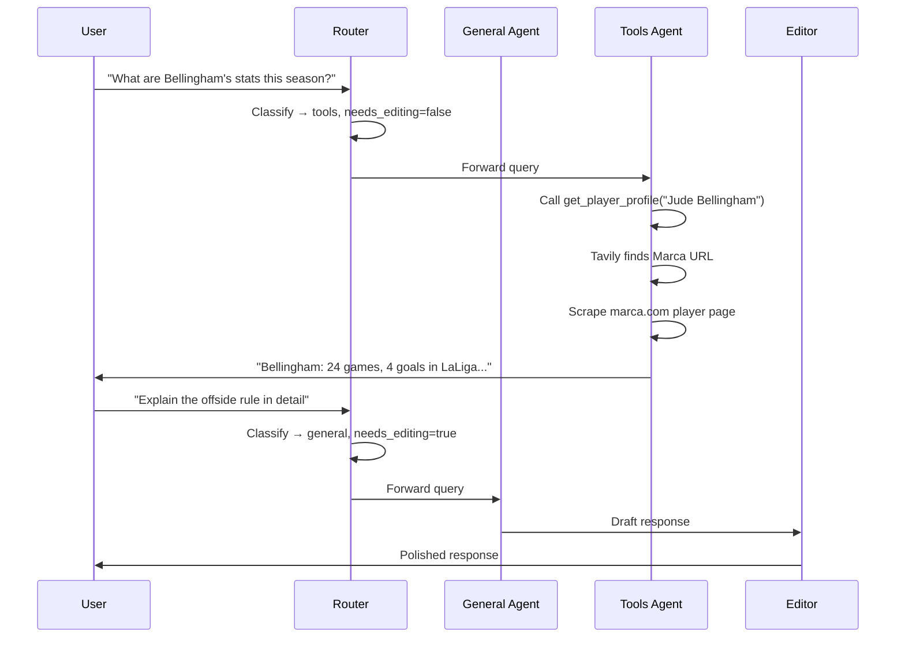

# ⚽ Football Multi-Agent System

A multi-agent system built with [LangGraph](https://github.com/langchain-ai/langgraph) and [Groq](https://groq.com/) that acts as a football (soccer) assistant. The system routes user queries through specialized agents and optionally polishes responses with an editor agent.

## Architecture

The system follows a **router → specialist → editor** pattern:



### Agents

| Agent | Role | Description |
|-------|------|-------------|
| **Router** | Classification | Classifies the query and decides the path. Uses Pydantic structured output to ensure valid routing decisions. |
| **General** | Knowledge | Answers questions using built-in football knowledge (rules, history, tactics, players). |
| **Tools** | Data retrieval | Uses web search (Tavily) and custom tools to fetch real-time player profiles and stats. |
| **Editor** | Writing | Rewrites the draft response for clarity and engagement. Only activated for complex queries. |

### Tools Available



| Tool | Description |
|------|-------------|
| **Tavily Web Search** | Real-time internet search for current football news and data. |
| **get_player_profile** | Fetches a player's full profile and current season stats from [Marca](https://www.marca.com). Uses Tavily to locate the player's Marca URL, then scrapes position, age, physical attributes, and per-competition stats (games, starts, goals, cards). |

## Project Structure

```
multi-agent-system/
├── src/
│   ├── nodes/
│   │   ├── router.py       # Query classification with Pydantic structured output
│   │   ├── general.py      # General football knowledge
│   │   ├── tools.py        # Agent with tool access
│   │   └── editor.py       # Response polishing
│   ├── tools/
│   │   └── football.py     # get_player_profile: Marca scraper
│   ├── config.py           # Prompts, model settings
│   ├── state.py            # Graph state schema
│   └── graph.py            # LangGraph definition
├── app.py                  # Streamlit chat UI
├── .env.example            # Required API keys
├── pyproject.toml
└── Makefile
```

## Setup

### 1. Create and activate the virtual environment

```bash
uv venv .venv
source .venv/bin/activate
```

### 2. Install dependencies

```bash
uv sync
```

### 3. Configure API keys

Copy the example file and fill in your keys:

```bash
cp .env.example .env
```

You need:
- **GROQ_API_KEY**: Free at [console.groq.com](https://console.groq.com)
- **TAVILY_API_KEY**: Free tier at [tavily.com](https://tavily.com)

### 4. Run the application

```bash
streamlit run app.py
```

## Graph Flow



## Configuration

All settings are centralized in `src/config.py` using dataclasses:

- **LLMConfig**: Model name and temperature per agent.
- **ToolsConfig**: Tool-specific parameters (e.g., max search results, Tavily topic).
- **PromptsConfig**: System prompts for each node.
